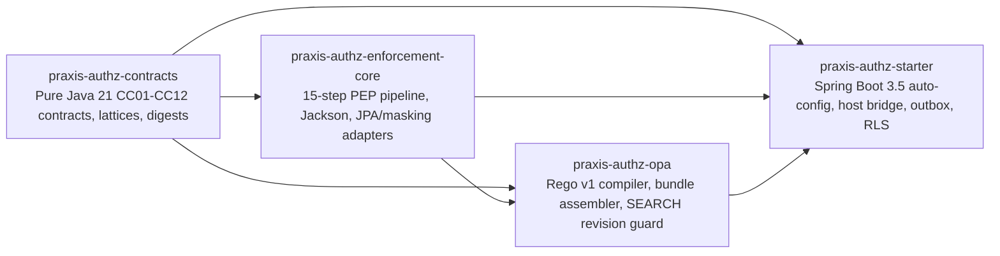
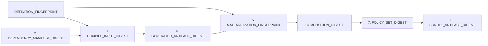

# Praxis Authz Contracts

[](https://central.sonatype.com/artifact/io.github.codexrodrigues/praxis-authz-contracts)

[](LICENSE)

Framework-neutral contracts, algebraic combining lattices, canonical SHA-256 digest calculators, Kleene 3-valued query semantics, and startup compatibility verifiers for the **Praxis Authorization Decision Platform** (`CC01–CC12`).

**Quick Links:**
[Maven Central](https://central.sonatype.com/artifact/io.github.codexrodrigues/praxis-authz-contracts) ·
[Changelog](CHANGELOG.md) ·
[Releasing](RELEASING.md) ·
[Contributing](CONTRIBUTING.md) ·
[Security Policy](SECURITY.md) ·
[Enforcement Core](https://github.com/codexrodrigues/praxis-authz-enforcement-core) ·
[OPA Provider](https://github.com/codexrodrigues/praxis-authz-opa) ·
[Spring Boot Starter](https://github.com/codexrodrigues/praxis-authz-starter)

---

## Praxis Decision Platform & Architectural Thesis

The **Praxis Platform** is a **semantically oriented platform for AI-native enterprise applications**, in which **resources, rules, actions, data, and policies are described once** and operated uniformly by **traditional UIs, generative UIs, AI agents, and integrations** — building applications that are legible and operable by AI by design rather than bolting AI onto the side.

Within the Praxis Decision Platform, `decisionKind = BUSINESS` and `decisionKind = AUTHORIZATION` are strictly orthogonal planes:

| Plane | Canonical Owner | Responsibilities |
| :--- | :--- | :--- |
| **Resource & Domain Semantics** | [`praxis-metadata-starter`](https://github.com/codexrodrigues/praxis-metadata-starter) | `@ApiResource`, `x-ui`, `/schemas/filtered`, `/schemas/domain`, `@DomainGovernance`, `@DomainLineage`, `@Filterable`, `@WorkflowAction`, `@UiSurface`, stats, and export |
| **Control Plane & Governed Decisions** | [`praxis-config-starter`](https://github.com/codexrodrigues/praxis-config-starter) / [`praxis-config-contracts`](https://github.com/codexrodrigues/praxis-config-contracts) | UI config, AI registry, API catalog grounding, maker-checker rule approvals, and snapshot head lifecycle (`/api/praxis/config/**`) |
| **`decisionKind = BUSINESS`** | [`praxis-rules-engine`](https://github.com/codexrodrigues/praxis-rules-engine) | Deterministic 5-state domain invariants, eligibility, and calculations (`RuleSet` / JSON Logic) |
| **`decisionKind = AUTHORIZATION`** | **`praxis-authz-contracts`** -> [`enforcement-core`](https://github.com/codexrodrigues/praxis-authz-enforcement-core) -> [`opa`](https://github.com/codexrodrigues/praxis-authz-opa) -> [`starter`](https://github.com/codexrodrigues/praxis-authz-starter) | `ACCESS`, row-level `DATA_SCOPE` (Kleene 3VL), query/projection `FIELD_USE`, pre-hydration `FIELD_WRITE`, detached DTO `MASK`, and `OBLIGATION` barriers |

**Module Boundary Guarantee:** `praxis-authz-contracts` compiles on **pure Java 21 with zero runtime dependencies**. `maven-enforcer-plugin` bans `org.springframework.*`, `org.springframework.boot.*`, `jakarta.persistence.*`, and `org.hibernate.orm.*` from the transitive runtime dependency tree so hosts, compilers, policy studios, and agents can share these contracts without framework lock-in.

---

## Four-Layer Authz Architecture



---

## Core Contract Closure Pack (`CC01–CC12`)

| Package | Key Types | Role |
| :--- | :--- | :--- |
| `...contracts.decisionpoint` | `DecisionPointIdentity`, `DecisionPointDescriptor`, `DecisionKind`, `DecisionPointKind`, `EnforcementCapability`, `FieldUseCategory`, `PointAuthorityMode` | Canonical decision-point grammar (`<kindPrefix>/<resourceKey>/<opOrActionKey>`), closed `FIELD_USE` categories (`VALUE`, `FILTER`, `SORT`, `GROUP`, `AGGREGATE`, `JOIN` — rejecting `EXPORT`, `LOOKUP`, `GROUP_BY`), and `GATE`/`VALUE` contract enforcement |
| `...contracts.context` | `FactDescriptor`, `FactContract`, `ContextCompositionProfile`, `ResolvedFactValue`, `FactResolutionStatus`, `ProviderInputProjection`, `TemporalContext` | 5-artifact context model (`EXTRACT -> ENRICH -> DERIVE`) and frozen 6-state fact resolution (`PRESENT`, `NULL`, `ABSENT`, `STALE`, `UNAVAILABLE`, `ERROR`) aligned with `DomainClassification`, `DomainDataCategory`, and `LegalTreatmentPurpose` |
| `...contracts.datascope` | `DataScopePlan`, `QueryableResourceProjection`, `QueryableFieldDescriptor`, `SearchPredicateIr`, `KleeneSearchPredicateEvaluator`, `KleeneTruthValue` | Persistence-neutral `praxis.data-scope/v1` query scope IR (`ALL`, `NONE`, `FILTER`) with exact Kleene 3-valued truth tables (`IS_NULL(ABSENT) = UNKNOWN`, `NOT(UNKNOWN) = UNKNOWN`) |
| `...contracts.binding` | `RuntimeEnforcementBinding`, `EnforcementPipelineStep`, `HostEnforcementPhase`, `WriteIntent`, `WriteChangeKind`, `ReadinessStage` | Binds decision points to `PointAuthorityMode`, captures pre-hydration `WriteIntent` (`SET`, `CLEAR_EXPLICIT_NULL`, `REMOVE`), and defines the invariant 15-step execution pipeline |
| `...contracts.policy` | `AuthorizationPolicyDefinition`, `AuthorizationPolicyRule`, `DefaultAuthorizationPolicyCandidateValidator`, `DualScopeDelegationSpec` | Schema `praxis.authorization-policy/v1` with bounded AST validation (`MAX_AST_DEPTH=12`, `MAX_AST_NODES=128`, `MAX_IN_LITERALS=64`, `MAX_REFERENCED_FACTS=32`) and disjoint `cedente`/`cessionario` custody |
| `...contracts.authority` | `EffectiveAuthorityBinding`, `ExecutionDispositionMode` | Deterministic convergence between baseline rules and provider authority without numeric priority |
| `...contracts.envelope` | `ProviderEvaluationEnvelope`, `DecisionEvidence`, `FieldUseEffectDirective`, `FieldWriteEffectDirective`, `MaskDirective`, `ObligationDirective` | Normalized provider outcomes (`ALLOW`/`DENY`/`NOT_APPLICABLE`, `PERMIT`/`DENY`) and sanitized audit evidence |
| `...contracts.masking` | `MaskStrategyRegistry`, `DefaultMaskStrategyRegistry`, `MaskMergeOutcome` | Commutative masking lattice across 7 standard strategies: `OMIT` (100) > `NULLIFY` (90) > `REDACT_CONSTANT` (80) > `HASH_TOKEN_KEYED` (70) > `SUMMARY_ONLY` (60) > `CPF_CNPJ_PARTIAL` / `PARTIAL_MASK` (50) |
| `...contracts.obligation` | `ObligationHandlerRegistry`, `DefaultObligationHandlerRegistry`, `ObligationTrigger`, `ObligationFulfillmentBarrier` | Fail-closed barrier semantics for `REQUIRE_MFA`, `REQUIRE_JUSTIFICATION`, `DURABLE_AUDIT_EVIDENCE`, and `WATERMARK` across `BEFORE_EXECUTION`, `BEFORE_COMMIT_OUTBOX`, and `BEFORE_DISCLOSURE` |
| `...contracts.digest` | `DigestDomainKind`, `CanonicalDigestCalculator`, `PolicyDigestChain`, `OpaRuntimeRelease`, `OpaRuntimeHead` | Domain-separated SHA-256 digests (`sha256:<64-hex>`) enforcing an 8-stage acyclic DAG (`Stage 1..8`) |
| `...contracts.compatibility` | `HostPolicyCompatibilityManifest`, `ImpactGraphBaseline`, `DefaultHostPolicyCompatibilityVerifier` | Bidirectional startup handshake (`praxis.host-policy-compatibility/v1`) verifying provider schemas, mask/obligation registries, projections, and fact contract digests |

### Eight Acyclic Digest Domains (`DigestDomainKind`)



---

## Maven Central Coordinates

Requires **Java 21**. Published on Maven Central with zero runtime dependencies:

```xml
<dependency>
    <groupId>io.github.codexrodrigues</groupId>
    <artifactId>praxis-authz-contracts</artifactId>
    <version>0.1.0-beta.1</version>
</dependency>
```

---

## Usage Examples

### 1. Canonical Decision Point Identity & Context Facts

```java
import org.praxisplatform.authz.contracts.context.ResolvedFactValue;
import org.praxisplatform.authz.contracts.decisionpoint.DecisionPointIdentity;

DecisionPointIdentity identity = DecisionPointIdentity.resourceOperation(
        "hr-service",
        "human-resources.employees",
        "filter"
);
// pointKey == "resource-operation/human-resources.employees/filter"

ResolvedFactValue orgUnits = ResolvedFactValue.present("subject.organizationUnitIds", Set.of("DEPT-10"));
ResolvedFactValue deletedAt = ResolvedFactValue.absent("resource.deletedAt");
```

### 2. Kleene 3-Valued Evaluation Over `SearchPredicateIr`

```java
import org.praxisplatform.authz.contracts.datascope.KleeneSearchPredicateEvaluator;
import org.praxisplatform.authz.contracts.datascope.KleeneTruthValue;
import org.praxisplatform.authz.contracts.datascope.NullabilityPredicateIr;
import org.praxisplatform.authz.contracts.datascope.SearchPredicateOperator;

NullabilityPredicateIr isNotDeleted = new NullabilityPredicateIr(
        SearchPredicateOperator.IS_NULL,
        "resource.deletedAt",
        "human-resources.employees:deletedAt"
);

// Structurally ABSENT/MISSING fact evaluates to UNKNOWN (never TRUE) under Kleene 3VL
KleeneTruthValue result = KleeneSearchPredicateEvaluator.evaluate(
        isNotDeleted,
        Map.of("resource.deletedAt", ResolvedFactValue.absent("resource.deletedAt"))
);
```

### 3. Acyclic Domain-Separated Digests (`DigestDomainKind`)

```java
import org.praxisplatform.authz.contracts.digest.CanonicalDigestCalculator;
import org.praxisplatform.authz.contracts.digest.DigestDomainKind;

String defDigest = CanonicalDigestCalculator.computeDigest(
        DigestDomainKind.DEFINITION_FINGERPRINT,
        canonicalDefinitionPayload
);

String manifestDigest = CanonicalDigestCalculator.computeDigest(
        DigestDomainKind.DEPENDENCY_MANIFEST_DIGEST,
        canonicalDependencyPayload
);

String compileDigest = CanonicalDigestCalculator.computeAcyclicDerivedDigest(
        DigestDomainKind.COMPILE_INPUT_DIGEST,
        List.of(DigestDomainKind.DEFINITION_FINGERPRINT, DigestDomainKind.DEPENDENCY_MANIFEST_DIGEST),
        defDigest + "\n" + manifestDigest
);
```

---

## Build, Verification & Governance

Run the local verification suite with JDK 21 and Maven 3.9+:

```powershell
mvn -B clean verify
```

Related repository documentation:
- [CHANGELOG.md](CHANGELOG.md) — version history and published artifacts
- [RELEASING.md](RELEASING.md) — multi-repository release order and Maven Central publication flow
- [ACTIONS-RELEASE-POLICY.md](ACTIONS-RELEASE-POLICY.md) — GitHub Actions usage and release gate policy
- [CONTRIBUTING.md](CONTRIBUTING.md) — module boundaries, enforcer rules, and contribution workflow
- [SECURITY.md](SECURITY.md) — vulnerability disclosure and fail-closed security invariants
- [AGENTS.md](AGENTS.md) — coding and governance rules for autonomous agents

## License

Licensed under the [Apache License, Version 2.0](LICENSE).
