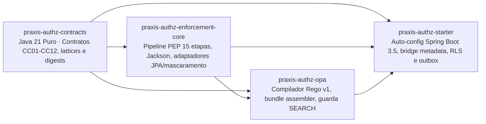
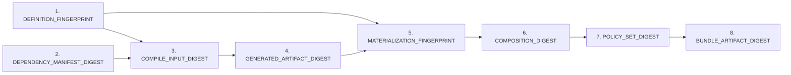

# Praxis Authz Contracts

[](https://central.sonatype.com/artifact/io.github.codexrodrigues/praxis-authz-contracts)


[](LICENSE)

Contratos leves e neutros de framework, lattices algébricos de combinação, calculadoras canônicas de digest SHA-256, semântica de consulta Kleene de 3 valores e verificadores de compatibilidade no startup para a **Praxis Authorization Decision Platform** (`CC01–CC12`).

**Links Rápidos:**
[Maven Central](https://central.sonatype.com/artifact/io.github.codexrodrigues/praxis-authz-contracts) ·
[Changelog](CHANGELOG.md) ·
[Guia de Release](RELEASING.md) ·
[Como Contribuir](CONTRIBUTING.md) ·
[Política de Segurança](SECURITY.md) ·
[Política de GitHub Actions](ACTIONS-RELEASE-POLICY.md) ·
[Regras para Agentes](AGENTS.md)

**Módulos da Família Authz (`0.1.0-beta.1`):**
**`praxis-authz-contracts`** (você está aqui) ·
[`praxis-authz-enforcement-core`](https://github.com/codexrodrigues/praxis-authz-enforcement-core) ·
[`praxis-authz-opa`](https://github.com/codexrodrigues/praxis-authz-opa) ·
[`praxis-authz-starter`](https://github.com/codexrodrigues/praxis-authz-starter)

---

## Sumário

1. [A Visão da Praxis Platform: Descreva Uma Vez, Opere em Todo Lugar](#a-vis%C3%A3o-da-praxis-platform-descreva-uma-vez-opere-em-todo-lugar)
2. [Que Problema Corporativo Este Módulo Resolve?](#que-problema-corporativo-este-m%C3%B3dulo-resolve)
3. [Por que a Solução Praxis Está à Frente do Mercado?](#por-que-a-solu%C3%A7%C3%A3o-praxis-est%C3%A1-%C3%A0-frente-do-mercado)
4. [Ganho em Tokens de IA, Contexto e Velocidade em Grandes Sistemas](#ganho-em-tokens-de-ia-contexto-e-velocidade-em-grandes-sistemas)
5. [Arquitetura em 4 Camadas e Cadeia de 8 Estágios de Digest](#arquitetura-em-4-camadas-e-cadeia-de-8-est%C3%A1gios-de-digest)
6. [Pacote de Fechamento de Contratos (`CC01–CC12`)](#pacote-de-fechamento-de-contratos-cc01cc12)
7. [Instalação via Maven Central](#instala%C3%A7%C3%A3o-via-maven-central)
8. [Exemplos Práticos de Uso](#exemplos-pr%C3%A1ticos-de-uso)
9. [Invariantes de Segurança e Fail-Closed](#invariantes-de-seguran%C3%A7a-e-fail-closed)
10. [Build, Verificação e Governança](#build-verifica%C3%A7%C3%A3o-e-governan%C3%A7a)

---

## A Visão da Praxis Platform: Descreva Uma Vez, Opere em Todo Lugar

A [**Praxis Platform**](https://praxisui.dev/) é uma **plataforma semanticamente orientada para aplicações corporativas AI-native**, em que **recursos, regras, ações, dados e políticas são descritos uma vez** e operados de maneira uniforme por **interfaces tradicionais, interfaces generativas, agentes de IA e integrações** — construindo sistemas legíveis e operáveis por IA por design, em vez de adaptar inteligência artificial como um remendo externo, sempre dentro de limites determinísticos e *fail-closed*.

Dentro da **Praxis Decision Platform**, os planos de **Regras de Negócio (`decisionKind = BUSINESS`)** e **Autorização e Proteção de Dados (`decisionKind = AUTHORIZATION`)** são estritamente ortogonais e integrados pelos demais projetos do ecossistema:

| Plano Arquitetural | Projeto(s) Canônico(s) | Papel na Solução Completa |
| :--- | :--- | :--- |
| **Semântica de Recursos e Domínio** | [`praxis-metadata-starter`](https://github.com/codexrodrigues/praxis-metadata-starter) | Publica `@ApiResource`, `x-ui`, `/schemas/filtered`, `/schemas/domain`, `@DomainGovernance`, `@DomainLineage`, `@Filterable`, `@WorkflowAction`, `@UiSurface`, estatísticas e exportação governada. |
| **Plano de Controle e Aprovações (PAP)** | [`praxis-config-starter`](https://github.com/codexrodrigues/praxis-config-starter) / [`praxis-config-contracts`](https://github.com/codexrodrigues/praxis-config-contracts) | Gerencia configurações de UI, registro de IA, catálogo de APIs, simulações, aprovações 4-olhos (*maker-checker*) e ciclo de revisões publicadas (`/api/praxis/config/**`). |
| **Motor de Negócio (`BUSINESS`)** | [`praxis-rules-engine`](https://github.com/codexrodrigues/praxis-rules-engine) | Avalia invariantes de domínio, cálculos e elegibilidade em 5 estados determinísticos (`RuleSet` / JSON Logic), executado no Passo 12 sobre o estado real não mascarado. |
| **Autorização e Proteção de Dados (`AUTHORIZATION`)** | **`praxis-authz-contracts`** → [`enforcement-core`](https://github.com/codexrodrigues/praxis-authz-enforcement-core) → [`opa`](https://github.com/codexrodrigues/praxis-authz-opa) → [`starter`](https://github.com/codexrodrigues/praxis-authz-starter) | Controla acesso (`ACCESS`), escopo relacional de linhas (`DATA_SCOPE` em Kleene 3VL), uso em consultas (`FIELD_USE`), bloqueio pré-hidratação de escrita (`FIELD_WRITE`), mascaramento em lattice (`MASK`) e barreiras de obrigações (`OBLIGATION`). |
| **Estação de Autoria e Auditoria** | [`praxis-rules-studio`](https://github.com/codexrodrigues/praxis-rules-studio) | Interface visual com **Lente de Regras de Negócio** e **Lente de Acesso e Proteção de Dados** para autoria, simulação e aprovação governada. |
| **UI Metadata-Driven** | [`praxis-ui-angular`](https://github.com/codexrodrigues/praxis-ui-angular) | Materializa tabelas, formulários, fluxos, visões 360° e restrições/máscaras em Angular diretamente a partir dos metadados do backend. |
| **Host de Referência e Provas HTTP** | [`praxis-api-quickstart`](https://github.com/codexrodrigues/praxis-api-quickstart) | Aplicação operacional completa com PostgreSQL e validação ponta a ponta em cenários corporativos reais. |

---

## Que Problema Corporativo Este Módulo Resolve?

Em sistemas corporativos complexos (RH/Folha, ERP, Financeiro, Setor Público), autorização de verdade envolve muito mais do que checar roles em endpoints REST:

1. **Contratos de segurança presos ao framework Web/ORM:** Quando regras de permissão dependem de Spring Security ou entidades Hibernate, ferramentas de autoria (PAP), sidecars OPA, gateways e agentes de IA não compartilham a mesma gramática sem importar todo o runtime da aplicação.
2. **Oráculos inferenciais em buscas (`FIELD_USE`):** Um usuário bloqueado de visualizar um salário não pode filtrar (`FILTER`), ordenar (`SORT`), agrupar (`GROUP`), agregar (`AGGREGATE`) nem fazer junção (`JOIN`) sobre esse campo para deduzir valores.
3. **Brechas silenciosas causadas por `NULL` em filtros negados:** Negar uma condição booleana simples sobre colunas anuláveis (`NOT (departamento = 10)`) frequentemente gera divergência entre a política teórica e o SQL gerado no banco.
4. **Falta de rastreabilidade entre código Java e pacote OPA publicado:** Alterar um campo de DTO em um microserviço enquanto o bundle OPA ainda espera a estrutura anterior produz decisões silenciosamente inválidas.
5. **Conflito de mascaramento entre múltiplas regras:** Quando duas políticas disparam sobre o mesmo campo sensível (ex.: uma pede `PARTIAL_MASK` e outra pede `OMIT`), faltava uma álgebra comutativa determinística que escolhesse sempre a proteção mais restritiva.

`praxis-authz-contracts` resolve todos esses desafios em um módulo Java 21 **com zero dependências de runtime**, fornecendo a gramática única compartilhada por todo o stack Praxis.

---

## Por que a Solução Praxis Está à Frente do Mercado?

| Capacidade | ABAC / `@PreAuthorize` Tradicional | Sidecar OPA sem Contrato Tipado | **Praxis (`praxis-authz-contracts` + família)** |
| :--- | :--- | :--- | :--- |
| **Semântica de Buscas e NULL (`DATA_SCOPE`)** | Queries HQL/SQL manuais sujeitas a falhas com valores nulos. | Rego retorna JSON livre sem padrão único de nulidade. | **`DataScopePlan` (`praxis.data-scope/v1`) avaliado com tabela-verdade Kleene 3VL exata (`IS_NULL(ABSENT) = UNKNOWN`, `NOT(UNKNOWN) = UNKNOWN`).** |
| **Prevenção de Oráculos em Consultas (`FIELD_USE`)** | Praticamente ausente; depende de checagem manual em cada `FilterDTO`. | Desenvolvedor precisa lembrar de validar filtros na mão. | **Categorias fechadas (`VALUE`, `FILTER`, `SORT`, `GROUP`, `AGGREGATE`, `JOIN`) rejeitam sinônimos soltos e bloqueiam oráculos antes do SQL.** |
| **Combinação de Máscaras (`MASK`)** | Código imperativo dependente da ordem de execução. | OPA não padroniza lattice de mascaramento Java/DTO. | **Lattice comutativo ordenado sobre 7 estratégias padrão (`OMIT` 100 > `NULLIFY` 90 > `REDACT_CONSTANT` 80 > `HASH_TOKEN_KEYED` 70 > `SUMMARY_ONLY` 60 > `CPF_CNPJ_PARTIAL` / `PARTIAL_MASK` 50).** |
| **Integridade Código ↔ Política** | Verificada apenas por testes manuais em runtime. | Difícil garantir compatibilidade entre schema Java e Rego. | **Cadeia SHA-256 em 8 domínios acíclicos (`DigestDomainKind`) + handshake bidirecional `praxis.host-policy-compatibility/v1` no startup.** |
| **Portabilidade de Runtime** | Presa a Spring/Jakarta EE. | Protocolo HTTP ad hoc. | **Zero dependências de runtime (`maven-enforcer-plugin` proíbe Spring, Boot, JPA e Hibernate no núcleo de contratos).** |

---

## Ganho em Tokens de IA, Contexto e Velocidade em Grandes Sistemas

Em plataformas com centenas de entidades e microserviços:

- **Contexto Compacto e Único para LLMs e Agentes:** Em vez de um agente de IA precisar ler dezenas de classes de configuração Spring, filtros JPA customizados, serializers Jackson e scripts SQL para entender quem acessa o quê, toda a gramática de autorização cabe nos contratos fechados de `praxis-authz-contracts` (identidade `DecisionPointIdentity`, fatos em 6 estados `ResolvedFactValue`, projeções consultáveis e AST limitada de política).
- **Redução de Retrabalho por Tipos Fechados:** Ao substituir strings livres e mapas não estruturados por records imutáveis, enums explícitos (`FieldUseCategory`, `WriteChangeKind`, `ObligationTrigger`) e limites estáticos (`MAX_AST_DEPTH = 12`, `MAX_AST_NODES = 128`), agentes de código geram integrações válidas logo nas primeiras iterações.
- **Governança Uniforme Multi-Equipe:** Novos recursos em [`praxis-metadata-starter`](https://github.com/codexrodrigues/praxis-metadata-starter) são automaticamente traduzidos para esses contratos via introspecção *Zero-Blueprint* no [`praxis-authz-starter`](https://github.com/codexrodrigues/praxis-authz-starter), acelerando a entrega corporativa sem precisar redesenhar contratos de segurança por módulo.

---

## Arquitetura em 4 Camadas e Cadeia de 8 Estágios de Digest



### Oito Domínios Acíclicos de Digest (`DigestDomainKind`)

`CanonicalDigestCalculator` gera hashes SHA-256 separados por domínio (`sha256:<64-hex>`) seguindo um grafo acíclico dirigido (`Stage 1..8`), garantindo detecção imediata de qualquer deriva entre definição, dependências, código compilado e bundle OPA:



---

## Pacote de Fechamento de Contratos (`CC01–CC12`)

| Pacote (`org.praxisplatform.authz.contracts...`) | Tipos Principais | Papel na Arquitetura |
| :--- | :--- | :--- |
| `...decisionpoint` | `DecisionPointIdentity`, `DecisionPointDescriptor`, `DecisionKind`, `DecisionPointKind`, `EnforcementCapability`, `FieldUseCategory`, `PointAuthorityMode` | Gramática canônica de pontos de decisão (`<kindPrefix>/<resourceKey>/<opOrActionKey>`), categorias fechadas de `FIELD_USE` (`VALUE`, `FILTER`, `SORT`, `GROUP`, `AGGREGATE`, `JOIN`) e contrato `GATE`/`VALUE` |
| `...context` | `FactDescriptor`, `FactContract`, `ContextCompositionProfile`, `ResolvedFactValue`, `FactResolutionStatus`, `ProviderInputProjection`, `TemporalContext` | Modelo de 5 artefatos (`EXTRACT -> ENRICH -> DERIVE`) e resolução congelada em 6 estados (`PRESENT`, `NULL`, `ABSENT`, `STALE`, `UNAVAILABLE`, `ERROR`) alinhada a `DomainClassification`, `DomainDataCategory` e `LegalTreatmentPurpose` |
| `...datascope` | `DataScopePlan`, `QueryableResourceProjection`, `QueryableFieldDescriptor`, `SearchPredicateIr`, `KleeneSearchPredicateEvaluator`, `KleeneTruthValue` | IR neutro de persistência `praxis.data-scope/v1` (`ALL`, `NONE`, `FILTER`) com tabelas-verdade Kleene de 3 valores (`IS_NULL(ABSENT) = UNKNOWN`, `NOT(UNKNOWN) = UNKNOWN`) |
| `...binding` | `RuntimeEnforcementBinding`, `EnforcementPipelineStep`, `HostEnforcementPhase`, `WriteIntent`, `WriteChangeKind`, `ReadinessStage` | Vincula pontos de decisão a `PointAuthorityMode`, captura `WriteIntent` pré-hidratação (`SET`, `CLEAR_EXPLICIT_NULL`, `REMOVE`) e fixa o pipeline invariante de 15 etapas (`STEP_01`..`STEP_15`) |
| `...policy` | `AuthorizationPolicyDefinition`, `AuthorizationPolicyRule`, `DefaultAuthorizationPolicyCandidateValidator`, `DualScopeDelegationSpec` | Esquema `praxis.authorization-policy/v1` com validação limitada de AST (`MAX_AST_DEPTH=12`, `MAX_AST_NODES=128`, `MAX_IN_LITERALS=64`, `MAX_REFERENCED_FACTS=32`) e custódia disjunta `cedente`/`cessionario` |
| `...authority` | `EffectiveAuthorityBinding`, `ExecutionDispositionMode` | Convergência determinística entre regras base e autoridade do provedor sem prioridades numéricas arbitrárias |
| `...envelope` | `ProviderEvaluationEnvelope`, `DecisionEvidence`, `FieldUseEffectDirective`, `FieldWriteEffectDirective`, `MaskDirective`, `ObligationDirective` | Respostas normalizadas do provedor (`ALLOW`/`DENY`/`NOT_APPLICABLE`, `PERMIT`/`DENY`) e evidências sanitizadas para auditoria |
| `...masking` | `MaskStrategyRegistry`, `DefaultMaskStrategyRegistry`, `MaskMergeOutcome` | Lattice comutativo sobre **7 estratégias padrão**: `OMIT` (`100`) > `NULLIFY` (`90`) > `REDACT_CONSTANT` (`80`) > `HASH_TOKEN_KEYED` (`70`) > `SUMMARY_ONLY` (`60`) > `CPF_CNPJ_PARTIAL` / `PARTIAL_MASK` (`50`) |
| `...obligation` | `ObligationHandlerRegistry`, `DefaultObligationHandlerRegistry`, `ObligationTrigger`, `ObligationFulfillmentBarrier` | Semântica de barreira *fail-closed* para `REQUIRE_MFA`, `REQUIRE_JUSTIFICATION`, `DURABLE_AUDIT_EVIDENCE` e `WATERMARK` nos momentos `BEFORE_EXECUTION`, `BEFORE_COMMIT_OUTBOX` e `BEFORE_DISCLOSURE` |
| `...digest` | `DigestDomainKind`, `CanonicalDigestCalculator`, `PolicyDigestChain`, `OpaRuntimeRelease`, `OpaRuntimeHead` | Digests SHA-256 separados por domínio (`sha256:<64-hex>`) impondo o DAG acíclico de 8 estágios |
| `...compatibility` | `HostPolicyCompatibilityManifest`, `ImpactGraphBaseline`, `DefaultHostPolicyCompatibilityVerifier` | Handshake bidirecional de startup (`praxis.host-policy-compatibility/v1`) validando esquemas do provedor, registries de máscara/obrigação, projeções e digests de contratos de fatos |

---

## Instalação via Maven Central

Requer **Java 21**. Publicado no Maven Central com **zero dependências de runtime**:

```xml
<dependency>
    <groupId>io.github.codexrodrigues</groupId>
    <artifactId>praxis-authz-contracts</artifactId>
    <version>0.1.0-beta.1</version>
</dependency>
```

---

## Exemplos Práticos de Uso

### 1. Identidade Canônica de Ponto de Decisão e Fatos em 6 Estados

```java
import java.util.Set;
import org.praxisplatform.authz.contracts.context.ResolvedFactValue;
import org.praxisplatform.authz.contracts.decisionpoint.DecisionPointIdentity;

DecisionPointIdentity identity = DecisionPointIdentity.resourceOperation(
        "hr-service",
        "human-resources.employees",
        "filter"
);
// pointKey == "resource-operation/human-resources.employees/filter"

ResolvedFactValue orgUnits = ResolvedFactValue.present("subject.organizationUnitIds", Set.of("DEPT-10"));
ResolvedFactValue deletedAt = ResolvedFactValue.absent("resource.deletedAt");
```

### 2. Avaliação Kleene de 3 Valores sobre `SearchPredicateIr`

```java
import java.util.Map;
import org.praxisplatform.authz.contracts.context.ResolvedFactValue;
import org.praxisplatform.authz.contracts.datascope.KleeneSearchPredicateEvaluator;
import org.praxisplatform.authz.contracts.datascope.KleeneTruthValue;
import org.praxisplatform.authz.contracts.datascope.NullabilityPredicateIr;
import org.praxisplatform.authz.contracts.datascope.SearchPredicateOperator;

NullabilityPredicateIr isNotDeleted = new NullabilityPredicateIr(
        SearchPredicateOperator.IS_NULL,
        "resource.deletedAt",
        "human-resources.employees:deletedAt"
);

// Fato estruturalmente ABSENT avalia para UNKNOWN (nunca TRUE) na lógica Kleene 3VL
KleeneTruthValue result = KleeneSearchPredicateEvaluator.evaluate(
        isNotDeleted,
        Map.of("resource.deletedAt", ResolvedFactValue.absent("resource.deletedAt"))
);
```

### 3. Digests Acíclicos Separados por Domínio (`CanonicalDigestCalculator`)

```java
import java.util.List;
import org.praxisplatform.authz.contracts.digest.CanonicalDigestCalculator;
import org.praxisplatform.authz.contracts.digest.DigestDomainKind;

String defDigest = CanonicalDigestCalculator.computeDigest(
        DigestDomainKind.DEFINITION_FINGERPRINT,
        canonicalDefinitionPayload
);

String manifestDigest = CanonicalDigestCalculator.computeDigest(
        DigestDomainKind.DEPENDENCY_MANIFEST_DIGEST,
        canonicalDependencyPayload
);

String compileDigest = CanonicalDigestCalculator.computeAcyclicDerivedDigest(
        DigestDomainKind.COMPILE_INPUT_DIGEST,
        List.of(DigestDomainKind.DEFINITION_FINGERPRINT, DigestDomainKind.DEPENDENCY_MANIFEST_DIGEST),
        defDigest + "\n" + manifestDigest
);
```

---

## Invariantes de Segurança e Fail-Closed

- **Verdade Estrita em Kleene 3VL:** Somente `KleeneTruthValue.TRUE` concede visibilidade; `UNKNOWN` e `FALSE` resultam em negação segura mesmo sob combinações lógicas complexas (`NOT`).
- **6 Estados Explícitos de Fato:** `PRESENT`, `NULL`, `ABSENT`, `STALE`, `UNAVAILABLE` e `ERROR` evitam que ausência de dado ou falha de enriquecimento seja confundida com valor nulo legítimo ou booleano `false`.
- **Lattice Comutativo de Mascaramento:** `OMIT` (100) prevalece deterministicamente sobre estratégias mais brandas como `PARTIAL_MASK` (50) independente da ordem em que políticas foram avaliadas.
- **Garantia de Fronteira (`maven-enforcer-plugin`):** Impõe Java `[21, 22)`, Maven `[3.9.0,)` e proíbe `org.springframework:*`, `org.springframework.boot:*`, `jakarta.persistence:*` e `org.hibernate.orm:*`.

---

## Build, Verificação e Governança

Execute a suíte de verificação (`CC01–CC12`) e travas do Enforcer com JDK 21 e Maven 3.9+:

```powershell
mvn -B clean verify
```

Documentação relacionada neste repositório:
- [CHANGELOG.md](CHANGELOG.md) — histórico de versões e artefatos publicados
- [RELEASING.md](RELEASING.md) — ordem de release multi-repositório e fluxo Maven Central
- [ACTIONS-RELEASE-POLICY.md](ACTIONS-RELEASE-POLICY.md) — política estrita de uso do GitHub Actions e gates de release
- [CONTRIBUTING.md](CONTRIBUTING.md) — fronteiras de módulo, regras do Enforcer e fluxo de contribuição
- [SECURITY.md](SECURITY.md) — divulgação responsável de vulnerabilidades e invariantes de segurança
- [AGENTS.md](AGENTS.md) — regras de engenharia e governança para agentes autônomos

## Licença

Distribuído sob a licença [Apache License, Version 2.0](LICENSE).
